<div align="center">

  <!-- Dynamic Typing Banner -->
  <a href="https://github.com/imLocutor">
    
  </a>

  <p align="center">
    <strong>Security Researcher & Systems Developer</strong> crafting resilient architectures, low-level game engine mechanics, and high-performance interactive interfaces.
  </p>

  <!-- Modern Flat Shields Badges -->
  <p align="center">
    
    
    
    
    
    
  </p>

</div>

---

### ⚡ Interactive Terminal Profile

<p align="center">
  <a href="https://github.com/imLocutor">
    
  </a>
</p>

<p align="center">
  <sub>💡 <em>Cartão dinâmico estilo Neofetch / Kali Terminal gerado e atualizado diariamente via GitHub Actions com avatar em arte ASCII e métricas em tempo real.</em></sub>
</p>

---

### 🛡️ About Me & Philosophy

```yaml
identity:
  name: "Lucas Borgov"
  handle: "imLocutor"
  affiliation: "EQPG Network"
  location: "US"

expertise:
  - "Cybersecurity, Game Engine Memory Safety & Reverse Engineering"
  - "Low-level system programming with C++ and C#"
  - "FiveM (Cfx.re) runtime internals, GTA V Natives & anti-cheat evasion defenses"
  - "Next-gen web applications built with Next.js 14, TypeScript & Tailwind CSS"

current_focus:
  - "Designing zero-overhead client & server security modules"
  - "Hardening networked multiplayer state synchronization"
  - "Developing modern responsive NUI interfaces with hardware acceleration"
```

---

### 🚀 Featured Repositories & Engineering Highlights

<table>
  <tr>
    <td width="50%" valign="top">
      <h4><a href="https://github.com/imLocutor/antiCL-NUI">🛡️ antiCL-NUI</a></h4>
      <p>
        <strong>High-Performance Combat Log Detection System</strong><br />
        Solução visual avançada que exibe notificações 3D espaciais em tempo real quando jogadores desconectam do servidor.
      </p>
      <ul>
        <li><strong>NUI Acceleration:</strong> Renderização 100% via Chromium Embedded Framework (CEF) para desempenho máximo (0.00ms idle).</li>
        <li><strong>Anti-OCR Immunity:</strong> Desenvolvido especificamente para evitar falsos positivos comuns em anti-cheats baseados em OCR.</li>
      </ul>
      <p>
        
        
      </p>
    </td>
    <td width="50%" valign="top">
      <h4><a href="https://github.com/imLocutor/arena-pro-front">🌐 arena-pro-front</a></h4>
      <p>
        <strong>Competitive Gaming & Esports Dashboard</strong><br />
        Frontend moderno, fluido e reativo construído para plataformas competitivas e gerenciamento de arenas.
      </p>
      <ul>
        <li><strong>Modern Stack:</strong> Next.js 14 App Router, TypeScript e Tailwind CSS.</li>
        <li><strong>UI/UX Premium:</strong> Componentes acessíveis com shadcn/ui, tipagem estrita e tema Dark Mode imersivo.</li>
      </ul>
      <p>
        
        
      </p>
    </td>
  </tr>
  <tr>
    <td width="50%" valign="top">
      <h4><a href="https://github.com/imLocutor/anti-fold">⚡ anti-fold</a></h4>
      <p>
        <strong>FiveM Exploit Mitigation Module</strong><br />
        Mecanismo defensivo projetado para neutralizar métodos de exploração de deformação de física/esqueleto (<em>folding / edging</em>) utilizados por softwares maliciosos para travar clientes de outros jogadores.
      </p>
      <p>
        
        
      </p>
    </td>
    <td width="50%" valign="top">
      <h4><a href="https://github.com/imLocutor/dpemotes-fixed">🎭 dpemotes-fixed</a></h4>
      <p>
        <strong>Optimized Animation & Emote Synchronizer</strong><br />
        Refatoração profunda da popular base de animações do FiveM com foco em estabilidade e sincronização de rede.
      </p>
      <ul>
        <li>Correção de vazamentos de memória (<em>memory leaks</em>) e desync em alta carga.</li>
        <li>Otimização do loop de execução para redução drástica do tempo de CPU.</li>
      </ul>
      <p>
        
        
      </p>
    </td>
  </tr>
</table>

---

<h3 align="center">Tech Stack & Tools</h3>

<p align="center">
  <a href="https://skillicons.dev">
    
  </a>
</p>

---

<h3 align="center">Contribution Activity</h3>

<p align="center">
  <picture>
    <source media="(prefers-color-scheme: dark)" srcset="https://raw.githubusercontent.com/imLocutor/imLocutor/main/assets/pacman-contribution-graph-dark.svg">
    <source media="(prefers-color-scheme: light)" srcset="https://raw.githubusercontent.com/imLocutor/imLocutor/main/assets/pacman-contribution-graph.svg">
    
  </picture>
</p>

---

### 💻 Weapons of Choice & Tech Radar

<div align="center">

| Categoria | Tecnologias & Ferramentas |
| :--- | :--- |
| **Sistemas & Low-Level** | `C++` `C# (.NET)` `Memory Analysis` `Reverse Engineering` `Pointer Tracing` |
| **Game Engine & FiveM** | `Cfx.re Framework` `GTA V Natives` `Lua 5.4` `NUI (CEF)` `Resource Optimization` |
| **Full-Stack & Web** | `TypeScript` `JavaScript` `Next.js 14` `React` `Tailwind CSS` `shadcn/ui` |
| **Segurança & Pesquisa** | `Anti-Cheat Architecture` `Exploit Analysis` `Packet Mitigation` `Process Forensics` |
| **Ferramental & DevOps** | `Git` `GitHub Actions` `Linux / Kali` `Docker` `VS Code` `Postman` |

</div>

---

### 📊 Live GitHub Insights & Analytics

<p align="center">
  
  
</p>

<p align="center">
  
</p>

---

### 🤝 Connect & Network

<p align="center">
  <a href="https://github.com/imLocutor">
    
  </a>
  <a href="https://github.com/imLocutor">
    
  </a>
  <a href="mailto:contact@imlocutor.dev">
    
  </a>
</p>

<p align="center">
  <sub>Criado com foco em segurança ofensiva/defensiva e engenharia de software de alto desempenho.</sub>
</p>
